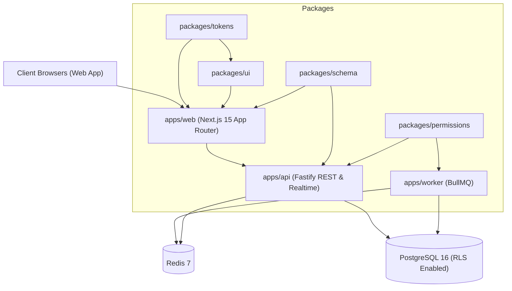
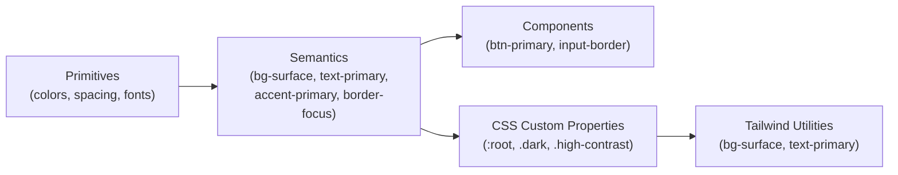

# Nexus CRM — Architecture Overview

## 1. System Context & Monorepo Structure

Nexus CRM is built as a **modular monolith** with clear package boundaries to maximize developer velocity and code reuse while preventing architectural degradation.



## 2. Security Boundaries & RLS Architecture

Every request to `apps/api` undergoes:
1. **Transport Security:** Strict TLS, HSTS, Secure `SameSite=Lax` cookies.
2. **Authentication Middleware:** Validates JWT access token or session cookie, resolves `user_id`.
3. **Workspace Context Resolution:** Extracts `workspace_id` from the active membership or request header `X-Workspace-ID`.
4. **PostgreSQL RLS Session Injection:**
   ```sql
   BEGIN;
   SET LOCAL app.workspace_id = 'c0a80101-0000-0000-0000-000000000001';
   SET LOCAL app.user_id = 'c0a80101-0000-0000-0000-000000000002';
   -- All queries within this transaction are automatically scoped
   COMMIT;
   ```
5. **Application-Level Scoping:** `packages/permissions` applies `where(eq(table.workspaceId, activeWorkspaceId))` for double defense.

## 3. Design Token Three-Tier Architecture


